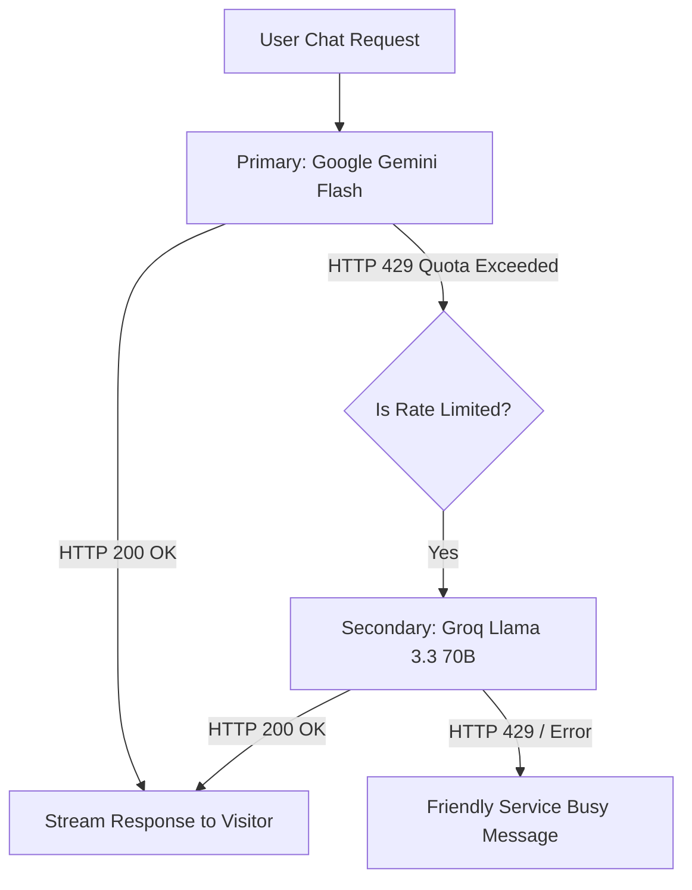

# OpenAgent Chat: Free Provider Strategy & Quota Limits

## 1. Objective
OpenAgent Chat is engineered to be fully deployable and operational using **100% free-tier cloud services** and open-source tooling, without sacrificing architectural integrity or pretending that impossible features work. This document provides a realistic assessment of provider quotas, limits, failover strategies, and clear boundaries.

---

## 2. LLM Providers: Free Tier Specifications & Rate Limits

| Provider | Model | Free Tier Allowance | Rate Limits (RPM / RPD / TPM) | Latency & Fit |
|---|---|---|---|---|
| **Google Gemini** | `gemini-1.5-flash` / `gemini-2.0-flash` | Generous free tier via Google AI Studio | **15 RPM** (Requests / Min) **1,500 RPD** (Requests / Day) **1,000,000 TPM** | Sub-second streaming TTFT, 1M context window, multilingual reasoning. **Primary default provider.** |
| **Groq Cloud** | `llama-3.3-70b-versatile` / `llama-3.1-8b-instant` | Free developer tier | **30 RPM** **14,400 RPD** (8B) **6,000 TPM** (70B) | Ultra-fast inference (500+ tok/s). Excellent for conversational speed and secondary fallback. |
| **Mistral AI** | `mistral-small-latest` | Free tier on La Plateforme | **1 RPS** (approx. 60 RPM) Strict monthly credit cap | Strong European language support. |
| **OpenAI / Custom** | `gpt-4o-mini` | BYOK (Bring Your Own Key) | Dependent on user tier | Enterprise fallback for tenants supplying their own API keys. |

---

## 3. Embedding Models & Vector Stores: Free Tier Capabilities

| Service | Mechanism | Allowance | Dimensionality | Constraints & Handling |
|---|---|---|---|---|
| **Google Gemini** | `text-embedding-004` | 1,500 requests/day free | 768 dimensions | Must batch chunk generation to prevent hitting 1,500 RPD during bulk website crawling. |
| **Hugging Face** | Serverless Inference (`BAAI/bge-small-en-v1.5`) | Free rate-limited API | 384 dimensions | Cold starts possible on dormant models; suitable as backup embedding service. |
| **Neon Postgres** | Cloud PostgreSQL with `pgvector` | 0.5 GiB storage, free compute units | Indexed via HNSW | Generous storage capacity (accommodates approx. 50,000 document chunks and 100,000 chat messages at zero cost). |

---

## 4. Multi-Provider Failover Architecture (Circuit Breaker)

To prevent downtime when free-tier rate limits are reached, the AI orchestration layer employs an automatic failover circuit breaker:

### Failover Rules:
1. When a provider returns **HTTP 429 (Too Many Requests)**, the orchestrator records a cooldown window (e.g. 60 seconds) for that provider.
2. The request is immediately retried on the secondary provider without dropping the visitor's connection.
3. If all configured free providers are exhausted, the system emits a clean, non-hallucinatory message:
   *"Our conversational assistant is currently experiencing high volume. Please check back in a few moments or contact support directly."*
   **Crucial Rule**: The system will never fabricate an AI response or fake a successful completion.

---

## 5. Technical Limitations & Non-Feasible Features on Free Tiers

In strict accordance with project rules (*"Jo cheez free provider ke saath technically possible na ho, usay clearly report kare; pretend na kare ke feature working hai"*), the following real limitations are acknowledged and handled transparently:

1. **Unbounded Web Crawling**:
   - *Limitation*: Crawling 500+ pages in a single click will instantly exhaust the Gemini embedding 1,500 RPD limit.
   - *Solution*: Bulk document ingestion is rate-throttled. Admin UI exposes a progress bar and limits single-site ingestion to 50 active pages on free tier mode.
2. **Sub-100ms Cold Starts on Serverless DBs**:
   - *Limitation*: Free serverless databases (e.g. Neon compute sleep) may experience a 1-2 second cold start on the first query after idle periods.
   - *Solution*: Connection keep-alive ping or transparent UI loading indicators during initial widget handshake.
3. **Dedicated GPU Ingestion / Heavy OCR**:
   - *Limitation*: Scanned image PDFs and complex layout parsing cannot run on free serverless endpoints without dedicated compute instances.
   - *Solution*: Ingestion strictly supports standard HTML, sitemaps, Markdown, and clean plain text in Phase 3. Complex OCR is marked as an enterprise extension.
4. **Guaranteed Uptime SLAs**:
   - *Limitation*: Free tier providers (Gemini AI Studio, Groq Developer, Neon Free) offer no financial or service-level uptime agreements.
   - *Solution*: System logs provider health metrics and offers seamless switching to self-provided API keys in site settings.
