# OpenAgent Chat: Implementation Roadmap

This roadmap establishes an engineering plan divided into independently testable and verifiable phases. Each phase has strict entry requirements, acceptance tests, and deliverables.

---

## Phase Overview & Dependency Graph

```mermaid
graph LR
    P0["Phase 0: Audit & Architecture (Current)"] --> P1["Phase 1: Workspace & Core Foundation"]
    P1 --> P2["Phase 2: Multi-Tenant Data & Admin API"]
    P2 --> P3["Phase 3: Document Ingestion & RAG Pipeline"]
    P3 --> P4["Phase 4: Provider Abstraction & AI Orchestrator"]
    P4 --> P5["Phase 5: Embeddable Web Component Widget"]
    P5 --> P6["Phase 6: Admin Dashboard & Management UI"]
    P6 --> P7["Phase 7: End-to-End Validation & Production Hardening"]
```

---

## Phase 0: Repository Audit & Architecture (Current Phase)
- **Goal**: Audit existing codebase, evaluate system environment, establish multi-tenant design, and create architectural specifications.
- **Key Tasks**:
  - [x] Inspect filesystem, runtimes, package tooling, and OS environment.
  - [x] Detect infrastructure constraints (e.g. absence of local Docker/Postgres).
  - [x] Define multi-tenant schema and tenant isolation rules.
  - [x] Document free provider strategies and real quota boundaries.
  - [x] Formulate testing strategy and threat model.
- **Verification Criteria**:
  - Comprehensive documentation generated in `docs/`.
  - Zero unverified assumptions or fake stubs.
  - Ready for architectural sign-off before code scaffolding.

---

## Phase 1: Workspace & Core Foundation
- **Goal**: Establish the monorepo workspace, shared type contracts, database schema, and test harness.
- **Key Tasks**:
  - Initialize `pnpm` monorepo with `apps/api`, `apps/web`, `apps/widget`, `packages/core`, `packages/db`, `packages/ai-provider`.
  - Configure root TypeScript configurations (`tsconfig.base.json`).
  - Implement `@openagent/core` containing shared Zod schemas (Tenant, Site, Message, KnowledgeDocument).
  - Implement `@openagent/db` with Drizzle ORM schema:
    - `tenants`, `sites`, `documents`, `document_chunks` (with pgvector), `conversations`, `messages`.
  - Setup migration scripts and database connection abstraction with Neon/PostgreSQL support.
  - Configure Vitest test runner across packages.
- **Verification Tests**:
  - `pnpm test` runs cleanly.
  - DB schema validation test passes (including type checks on vector columns).
  - Monorepo package resolution works across all workspaces.

---

## Phase 2: Multi-Tenant Data Layer & Admin API
- **Goal**: Implement server-side multi-tenant API routes for site management, configuration, and tenant isolation enforcement.
- **Key Tasks**:
  - Implement backend REST API in `apps/api` using Hono or Fastify.
  - Public route: `GET /api/v1/site/config` (resolves public site configuration by `site_id` or `public_key`).
  - Origin verification middleware: Rejects requests whose `Origin` header is not whitelisted in `sites.allowed_origins`.
  - Admin management endpoints: CRUD for tenants, sites, branding settings, and system prompts.
  - Admin authentication guard (JWT/Session-based).
  - Rate limiting middleware per IP and per `site_id`.
- **Verification Tests**:
  - Unit tests verifying origin checks (allowed vs rejected domains).
  - Integration tests ensuring Tenant A cannot read or mutate Site B's configuration.
  - Rate limiting unit test simulating burst traffic.

---

## Phase 3: Document Ingestion & RAG Pipeline
- **Goal**: Build ingestion engine that parses text/HTML/sitemaps and indexes chunks into PostgreSQL with pgvector embeddings.
- **Key Tasks**:
  - Document chunking utility: Recursive token/character splitting with configurable overlap (e.g. 500 chars with 50 char overlap).
  - Ingestion API: `POST /api/v1/ingestion/text`, `POST /api/v1/ingestion/crawl`.
  - Embedding pipeline: Generates embeddings using Gemini `text-embedding-004` (free) or HuggingFace fallback.
  - Vector search query builder: Cosine similarity operator (`<=>`) strictly bounded by `site_id`.
  - Retention & deletion workflows: Complete purge of site document chunks upon request.
- **Verification Tests**:
  - Ingestion test: Ingest sample FAQ document, verify chunks stored in DB with non-null embeddings.
  - Cross-tenant RAG test: Ensure query on Site A returns 0 results even if Site B contains identical query keywords.
  - Cosine similarity ranking test: High-relevance chunk ranked top.

---

## Phase 4: Provider Abstraction & AI Orchestration
- **Goal**: Create a robust, streaming LLM interface supporting free providers (Gemini, Groq) with prompt synthesis and grounded responses.
- **Key Tasks**:
  - Create standardized `LLMProvider` interface in `packages/ai-provider`:
    - `generateStream(messages, options): AsyncIterable<string>`
  - Implement Google Gemini adapter (`@google/genai` or direct REST with streaming SSE).
  - Implement Groq adapter (Llama 3.3 70B via OpenAI-compatible endpoint).
  - Automatic fallback handler: If Provider 1 returns HTTP 429 (quota exceeded), failover to Provider 2.
  - Multilingual prompt builder:
    - Injects language matching rules (respond in visitor's language).
    - Injects retrieved site knowledge.
    - Adds grounding constraints (prevents hallucination and off-topic chat).
  - Streaming endpoint: `POST /api/v1/chat/stream` delivering Server-Sent Events.
- **Verification Tests**:
  - Mock and live provider tests validating SSE streaming format.
  - Fallback logic unit test: Simulates 429 response and confirms secondary provider is engaged.
  - Grounding test: Validates prompt template instructs model to reject ungrounded questions.

---

## Phase 5: Embeddable Web Component Widget
- **Goal**: Build a self-contained, lightweight JavaScript bundle that renders an interactive chat interface in Shadow DOM.
- **Key Tasks**:
  - Implement widget in `apps/widget` with Preact/Web Components.
  - Mount inside custom element `<openagent-chat>` with Shadow Root.
  - Chat Bubble trigger button with customizable position, icon, and colors.
  - Chat Window with:
    - Header (Site logo, bot name, close/minimize button).
    - Message history list with smooth autoscroll.
    - Real-time streaming response renderer (SSE markdown chunks).
    - Input area with submit button, character counter, and loading state.
    - Source citation chips displaying document titles/URLs.
  - Session persistence: Stores visitor session ID in `localStorage` scoped to `site_id`.
  - Single-file bundle compilation via `tsup`/`vite` to `dist/widget.js`.
- **Verification Tests**:
  - Bundle size check: Confirms gzipped bundle is under 35 KB.
  - Shadow DOM CSS leakage test: Verifies external host styles do not distort widget elements.
  - SSE client test: Verifies chunk accumulation and error handling.

---

## Phase 6: Admin Dashboard & Management UI
- **Goal**: Build modern web dashboard for site owners to manage settings, upload knowledge, test the bot, and view conversations.
- **Key Tasks**:
  - Site settings manager: Configure bot name, welcome message, colors, system prompt, allowed origins.
  - Knowledge base manager: Upload text, crawl URLs, view indexed chunk counts.
  - Embedded widget tester: Live in-browser playground testing the widget against site knowledge.
  - Conversation logs viewer: Searchable, filterable visitor chat sessions with source citations.
- **Verification Tests**:
  - E2E flow in dashboard: Create site -> update branding -> verify settings retrieved by public API.

---

## Phase 7: Production Hardening, Security Audit & Deployment
- **Goal**: End-to-end security audit, automated CI/CD pipeline, and deployment documentation.
- **Key Tasks**:
  - Comprehensive STRIDE security validation (CORS, prompt injection, CSRF, key isolation).
  - Automated CI test suite covering unit, integration, and build checks.
  - Production deployment configuration (Docker container, Vercel/Railway instructions, CDN cache rules).
  - Verification on multiple sample host web pages.
- **Verification Tests**:
  - Automated test pass rate 100%.
  - Zero secret leakage in all client bundles.
  - Full end-to-end embedding verification on clean external HTML test page.
